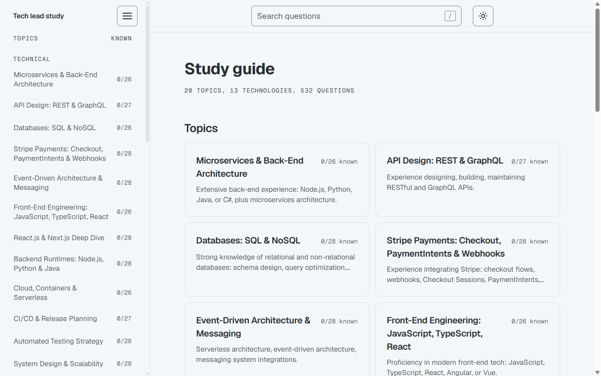
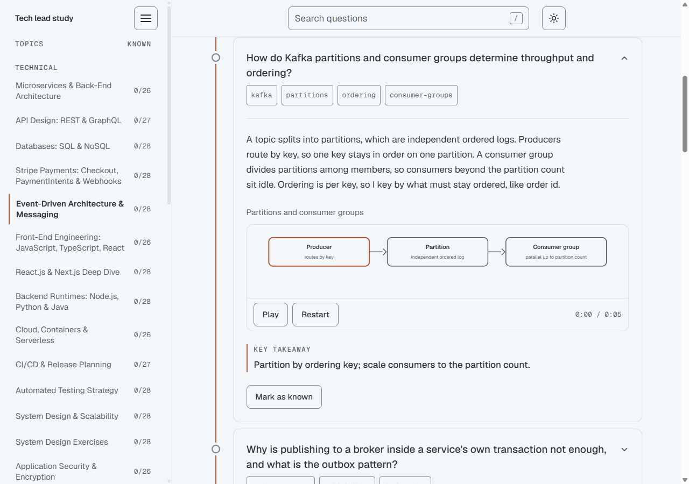
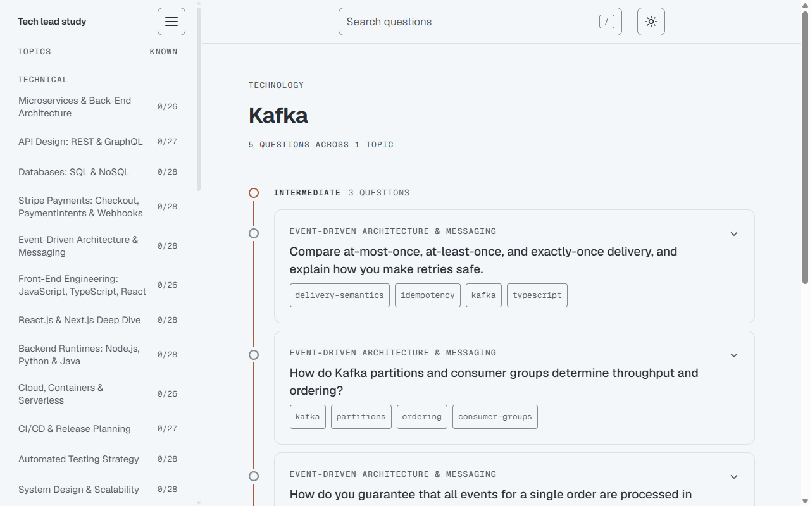
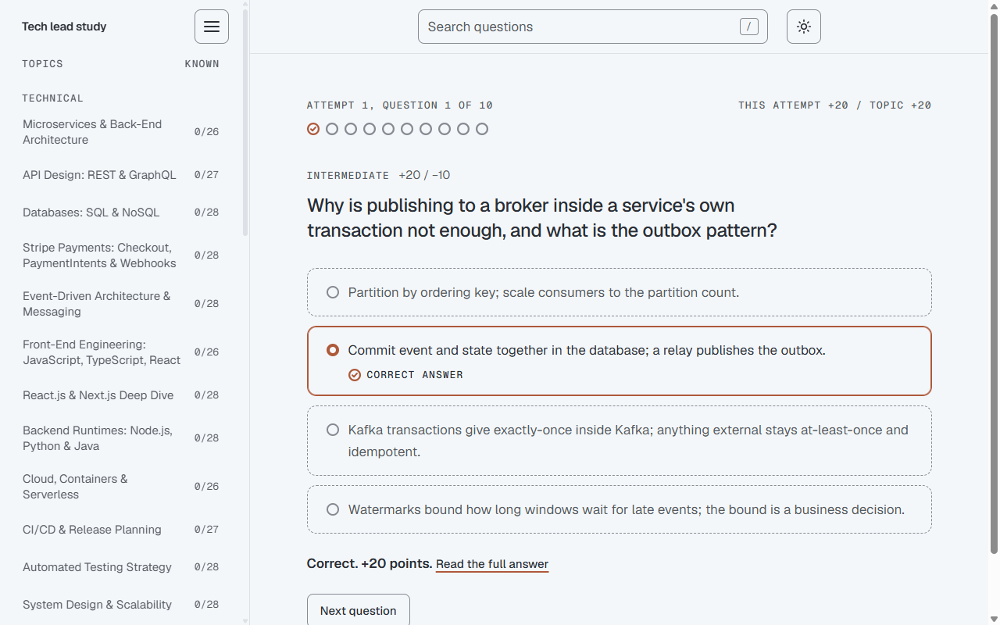
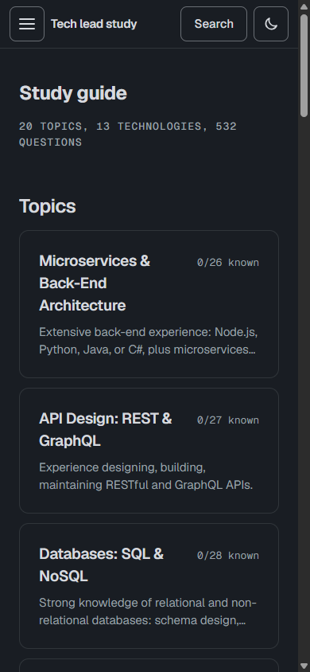

# Technical Lead Study Guide

A free study site for people preparing for a Technical Lead interview. It has 532 questions with model answers, a quiz for every topic, and a place to track what you already know.

**At a glance**

- **Who it is for:** people who prepare for a Technical Lead interview.
- **Cost:** free.
- **Status:** runs on your own computer. No public host is chosen yet.



## What it is

The questions follow a Technical Lead job description: 5 to 7 years of experience, full-stack work, plus leading a team. The guide covers what that role asks for. There are 14 technical topics, such as microservices, databases, system design and security. There are also 6 topics on the people side of the job, such as code review, mentoring, working with stakeholders and the HR round.

Visitors never need an account. Their progress and quiz scores stay in their own browser. Accounts exist only for the site admin, who edits the content (see "Editing the content"). The admin's progress also syncs to the backend.

## Read the answers

Open a topic and you see its questions laid out along one line, from basic to intermediate to advanced. Click a question to open the answer. Each answer ends with a one-line key takeaway, so you can skim a whole topic in a few minutes and still come away with the main point of every question.

Most answers come with a short animated diagram that you play, pause and restart yourself, and 62 of them add a code snippet.



## Find questions by technology

You might not be studying a whole topic. Maybe you have an interview where they will ask about Kafka, or Kubernetes, or Next.js. Pick the technology from the sidebar or from the home page, and you get every question about it from all the topics in one list. Each card shows which topic it came from.

There are 13 technologies: AWS, Docker, GraphQL, gRPC, Java, Kafka, Kubernetes, Next.js, Node.js, OAuth/JWT, React, Stripe and Terraform.

Every question also carries small tags such as `kafka` or `idempotency`. Click one to see all questions that share it.



## Test yourself with a quiz

Each topic has a quiz. An attempt asks 10 questions in random order, and you pick the right takeaway from four options. A correct answer earns 10, 20 or 30 points depending on the difficulty. A wrong answer costs half of that. The next attempt skips the questions you just saw.



## Keep track of what you know

Press "Mark as known" on any answer. The sidebar and the home page show a count for each topic and technology, like 12/28, so you can see where the gaps are. Your progress and quiz scores stay in your browser's local storage. Clear your browser data and they go away.

Visitors have no sign-in, so this progress stays on the device. The admin account is the exception: while the admin is signed in, known questions and quiz scores also sync to the site's backend, which is the same API that serves the site's content. See [docs/TECHNICAL.md](docs/TECHNICAL.md) for how that fits together.

## Small things that help

The site has search, a dark mode, a full-screen mode, and a phone layout. The shortcut keys are in [docs/TECHNICAL.md](docs/TECHNICAL.md).



## How it is built

The project has two parts:

- **Frontend:** the website people see. It runs on http://localhost:3000.
- **Backend:** the service that stores the questions and the accounts. It runs on http://localhost:3001.

The frontend shows no pages unless the backend runs, so set up the backend first.

## Backend setup

You need Node.js and PostgreSQL.

1. Create the two databases. `technical_lead_test` is only for the tests.

   ```bash
   psql -U postgres -h 127.0.0.1 -c "CREATE DATABASE technical_lead;"
   psql -U postgres -h 127.0.0.1 -c "CREATE DATABASE technical_lead_test;"
   ```

2. Install the packages and create the settings file:

   ```bash
   cd server
   npm install
   cp .env.example .env
   ```

3. Open `server/.env` and fill in `BETTER_AUTH_SECRET` and `EXPORT_TOKEN`. The file shows the command that makes each value. The other values work as they are on your own computer.
4. Create the tables, then start the backend:

   ```bash
   npm run migrate
   npm run start:dev
   ```

5. Open http://localhost:3001/v1/health/live to check that it runs.

The new tables are empty. The questions live in the database, so restore them from a `pg_dump` backup on a new computer.

## Frontend setup

From the main project folder:

```bash
npm install
npm run dev
```

Open http://localhost:3000. If the backend is off, pages show a "Content is not available" message.

For a production build, run `npm run build` and then `npm start`. The old GitHub Pages deploy was removed, because the site needs a host that can run Node. Until a host is chosen, a GitHub check only lints and builds the app. More detail is in [docs/TECHNICAL.md](docs/TECHNICAL.md).

## Editing the content (for the site owner)

Questions and topics can be edited in the browser on the `/admin` page. It is not linked from the site and search engines are told to skip it. To use it, create an account on the `/login` page, then grant that account the admin role from the command line (`npm run admin:grant -- <email>` inside `server/` shows the account; check that you made it, then run it again with `--yes`). After you sign in, `/admin` shows the content editor, and the Account page there changes your password. If you forget it, use "Forgot password?" on the sign-in screen; in development the mail is caught by MailHog and you read it at http://localhost:8025 (setup in [docs/TECHNICAL.md](docs/TECHNICAL.md)). Saved edits go into the database, and the public site shows them the next time a page loads. Setup and details: [docs/TECHNICAL.md](docs/TECHNICAL.md).

## For developers

How the code is organized, the design tokens, how each control behaves with keyboard and touch, the deploy setup and package versions are in [docs/TECHNICAL.md](docs/TECHNICAL.md).
